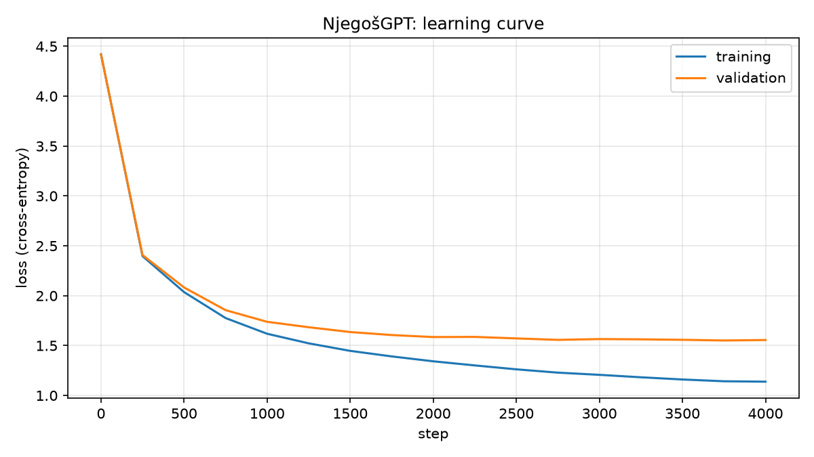

# NjegošGPT

A character-level GPT, written from scratch in PyTorch and trained on the works of
[Petar II Petrović Njegoš](https://en.wikipedia.org/wiki/Petar_II_Petrovi%C4%87-Njego%C5%A1) (1813-1851),
the Montenegrin prince-bishop and poet who wrote *Gorski vijenac* (The Mountain Wreath).

Code and slides for the live tutorial **"Let's make NjegošGPT!"** at Data Science Conference 2026 (DSC 2026).
The model is about 150 lines, the training script about 200. It follows Andrej Karpathy's
[nanoGPT](https://github.com/karpathy/nanoGPT).

## Result

10.75M parameters, 1.4M characters of text, 4000 training steps. The model sees only characters. Nobody
tells it what a word, a verse or a speaker label is.

Sample from the best checkpoint, prompted with `VLADIKA DANILO`:

```
VLADIKA DANILO
Nemoj se od više gore
od prestola i krilati,
da nijesu ni grdan dali
do čistoga u duboke sile,
da je vaše slobodnost našemu
otkriti mi ne bi znao lije.

KNEZ ROGAN
Poslijed pred njima ne može
kad im se čudi za svojim ljudima;
što bi vi ste svagda za prestol.

SAV NAROD (poje)
A bogom vi se, a to ne možemo,
poslijed znati, nijesam mnogo lijepo!
```

It is not meaningful Serbian, and it is not Njegoš. What it did learn: real words and names from the corpus,
the Ijekavian dialect, the layout of a verse drama with speaker labels and stage directions, and lines of
roughly ten syllables (the *deseterac* of South Slavic epic poetry). At step 0 the same model prints
`sr"SšhdB8g"a(ć;8guuiFĆNLć'..Pf' vnĐExK?hx-f77xN`.

More output: [results/sample.txt](results/sample.txt) (unprompted, 3000 characters) and
[results/sample_vladika_danilo.txt](results/sample_vladika_danilo.txt).

### Loss

The objective is next-character prediction: cross-entropy between the predicted distribution and the
character that actually follows, averaged over every position of every sequence in the batch.

$$\mathcal{L} = -\frac{1}{BT}\sum_{b=1}^{B}\sum_{t=1}^{T} \log p_\theta\left(y_{b,t} \mid x_{b,\le t}\right)$$



| step | train loss | val loss |
|---:|---:|---:|
| 0 | 4.4202 | 4.4191 |
| 1000 | 1.6186 | 1.7383 |
| 2000 | 1.3424 | 1.5854 |
| 3000 | 1.2068 | 1.5653 |
| **3750** | **1.1423** | **1.5511** |
| 4000 | 1.1382 | 1.5557 |

An untrained model should be uniform over the 81 characters, so the loss should start at ln 81 = 4.39.
It starts at 4.42. Validation loss flattens after step 2000 while training loss keeps falling: with 10.75M
parameters and 1.4M characters the model starts to memorize. `train.py` keeps the checkpoint with the lowest
validation loss, here step 3750. Full log: [results/log.csv](results/log.csv).

The reference run was trained on a single RTX 4090. The same script runs on Apple Silicon (MPS) and on CPU.

## Run it

Requires [uv](https://docs.astral.sh/uv/) and Python 3.12.

```bash
uv sync

# 1. Build the corpus: downloads the sources, cleans them, writes data/njegos.txt
uv run prepare_data.py

# 2. Train. Writes out/ckpt.pt, out/log.csv and a text sample at every evaluation
uv run train.py                  # full model, 10.75M parameters
uv run train.py --preset=demo    # small model for a quick run, 3.23M parameters

# 3. Sample and plot
uv run sample.py --start="VLADIKA DANILO\n" --temperature=0.8 --top_k=20
uv run plot_loss.py
```

Every value in the config block at the top of `train.py` can be overridden as `--key=value`, for example
`--max_iters=2000 --dropout=0.2`.

To sample without training, download the checkpoint of the reference run from the
[releases page](https://github.com/permitt/dsc_njegosgpt/releases):

```bash
curl -L -o ckpt.pt https://github.com/permitt/dsc_njegosgpt/releases/download/v1.0/ckpt.pt
uv run sample.py --ckpt ckpt.pt --start="VLADIKA DANILO\n" --temperature=0.8 --top_k=20
```

Tests: `uv run pytest`.

## What is in the repo

| File | What it does |
|---|---|
| `model.py` | The GPT: causal self-attention, MLP, transformer block, generation loop |
| `train.py` | Character tokenizer, batching, AdamW with warmup and cosine decay, evaluation, checkpointing |
| `sample.py` | Generates text from a checkpoint, with temperature and top-k |
| `plot_loss.py` | Plots the loss curve from `log.csv` |
| `prepare_data.py` | Downloads, cleans and transliterates the corpus |
| `presentation/index.html` | The slides, a single HTML file |
| `results/` | Loss log, loss plot and samples of the reference run |
| `tests/` | Tests for the model (shapes, initial loss, causal masking) and the data pipeline |

## Model

A decoder-only transformer in the GPT-2 layout: learned token and position embeddings, pre-LayerNorm blocks
with residual connections, a 4x MLP with GELU, and weight tying between the input embedding and the output
layer.

| | full | `--preset=demo` |
|---|---:|---:|
| layers | 6 | 4 |
| heads | 6 | 4 |
| embedding size | 384 | 256 |
| context (characters) | 256 | 256 |
| batch size | 64 | 64 |
| dropout | 0.3 | 0.3 |
| steps | 4000 | 1000 |
| parameters | 10.75M | 3.23M |

Optimizer: AdamW (betas 0.9 and 0.99, weight decay 0.1 on matrices and embeddings only), learning rate 1e-3
with 100 warmup steps and cosine decay to 1e-4, gradient clipping at 1.0. On CUDA the script uses bfloat16
autocast and `torch.compile`.

`model.py` has two attention paths that compute the same thing: `F.scaled_dot_product_attention` (default)
and an explicit `softmax(QK^T / sqrt(d)) V` with a causal mask, which is the one shown on the slides. Set
`use_flash=False` in `GPTConfig` to run the explicit one. A test checks that they agree.

## Data

1,401,864 characters, 81 distinct characters, Serbian Latin script. The corpus covers Njegoš's poems, epics
and verse dramas (*Gorski vijenac*, *Luča mikrokozma*, *Lažni car Šćepan Mali*, *Svobodijada*), his letters
and prose, and *Ogledalo srpsko*, an anthology of mostly folk epic songs that he compiled. The last 10% of
the text is the validation set.

Tokenization is one character, one token. Cyrillic sources are transliterated to Latin, so `љ`, `њ` and `џ`
become two tokens each (`lj`, `nj`, `dž`).

The corpus is not stored in this repository. `prepare_data.py` rebuilds it from two sources:

- [sr.wikisource.org](https://sr.wikisource.org) for the texts it has.
- The electronic *Sabrana dela* from [ppnjegos.com](https://ppnjegos.com/sabdela.htm) (ed. Aleksandar Lazić,
  XML by Predrag Janičić and Aleksandar Gogić, 2024) for the rest. Njegoš's text is in the public domain,
  but this edition is published under CC BY-ND 4.0, which is why the processed corpus is not redistributed
  here.

Per-work character counts, source URLs and cleaning rules are in [data/SOURCES.md](data/SOURCES.md).

## Slides

Open `presentation/index.html` in a browser. Fonts and libraries load from CDNs, so it needs a connection.

| Key | Action |
|---|---|
| arrows, space | next and previous slide |
| `o` | overview of all slides |
| `s` | speaker notes with a timer |
| `f` | fullscreen |

## Credits

- Andrej Karpathy: [nanoGPT](https://github.com/karpathy/nanoGPT) and
  [Let's build GPT: from scratch, in code, spelled out](https://www.youtube.com/watch?v=kCc8FmEb1nY).
- Vaswani et al., [Attention Is All You Need](https://arxiv.org/abs/1706.03762) (2017).
- Wikisource contributors and the editors of the ppnjegos.com edition for the texts.

Mitar Perović · [github.com/permitt](https://github.com/permitt) · [linkedin.com/in/perovicmitar](https://www.linkedin.com/in/perovicmitar)
